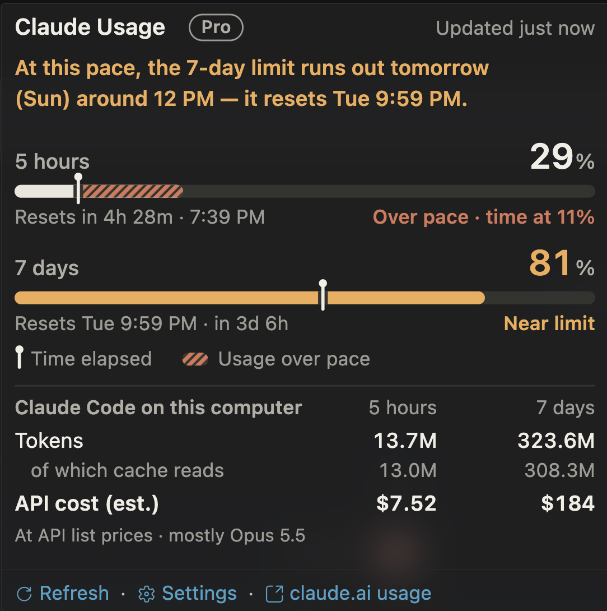

<p align="center">
  
</p>

<h1 align="center">Pacelight</h1>

<p align="center">
  <b>Will you make it to the reset?</b><br>
  Your Claude subscription's 5-hour and 7-day usage, paced against the clock, right in the VS Code status bar.
</p>

<p align="center">
  <a href="#install">Install</a> ·
  <a href="#features">Features</a> ·
  <a href="#privacy">Privacy</a> ·
  <a href="#settings">Settings</a> ·
  <a href="README.zh-TW.md">繁體中文</a>
</p>

<p align="center">
  
</p>

<p align="center"><sub>Unofficial community project. Not affiliated with, endorsed by, or sponsored by Anthropic.</sub></p>

## At a glance

Pacelight sits in the status bar next to "✻ Claude Code" and stays out of the way until something needs your attention.

| Status bar | Color | What it means |
|:--|:--|:--|
| `5h 8% · 7d 12%` | — | On track. This is what you'll see most of the time. |
| `5h 13% · 7d 54% over pace` | — | At this pace, the 7-day limit runs out before it resets. |
| `5h 86% · resets in 42m` | Warning | A window reached 80%. Only that window is shown, with its reset time. |
| `7d 97% · resets Fri 5:35 PM` | Error | A window reached 95% or ran out (`5h used up · resets in 30m`). |
| `5h 13% · 7d 54% over pace` with a clock or unplugged icon | — | Out of date: the server couldn't be reached, or the login needs refreshing. Hover to see why. |

## Features

- **Quiet until it matters.** Two numbers, nothing else. The status bar only changes when a limit needs your attention.
- **Pace, not just percent.** 54% means little on its own. Pacelight compares each window's usage with how much of its time has passed, and tells you when you're on track to run out early.
- **A straight answer.** Hover, and the first sentence answers the question you actually have: *"At this pace, the 7-day limit runs out tomorrow (Fri) around 11 PM, 3d 22h before it resets."* Then how to make it: *"To last until Tue 10:00 PM, keep it under 8% a day."*
- **See the pace.** Each window gets a bar with a marker for how much of its time has passed. The hatched part past the marker is usage that's over pace.
- **What it would have cost.** The tokens Claude Code used on this computer in each window, and what they would cost at Anthropic API list prices.
- **Every limit on your plan.** Per-model weekly limits, like Max's Sonnet-only limit, appear on the card and trigger the warning colors too.
- **Light on the network.** One request every 2 minutes by default, shared by all VS Code windows, with back-off on errors.
- **Readable without color.** States are spelled out in words, and the status bar and card have screen reader text.
- **English and 繁體中文.**

Click the status bar item to refresh right away.

## Install

You need VS Code 1.90 or later, and Claude Code signed in with a Claude subscription (Pro, Max, …). API-key logins have no plan usage.

1. Download `pacelight-<version>.vsix` from the [latest release](https://github.com/macacacacaca/pacelight/releases/latest).
2. In VS Code, run **Extensions: Install from VSIX…** from the Command Palette and pick the file. Or, in a terminal: `code --install-extension pacelight-<version>.vsix`

Tested on macOS. On Linux and Windows it reads the credentials file from the location given in Claude Code's documentation, but this is untested. To build from source, see [Development](#development).

## Privacy

| | What Pacelight does |
|:--|:--|
| **Data collected** | None. No telemetry, no analytics. |
| **Network** | One request: `GET https://api.anthropic.com/api/oauth/usage`. Nothing else is contacted. |
| **Your login token** | Read from Claude Code's own storage and sent only to `api.anthropic.com`. Never written to logs or disk, and never refreshed. |
| **Your transcripts** | Only token counts, model names, and timestamps are kept, in memory. Conversation content is never stored or sent. |
| **On disk** | `last-usage.json` in the extension's storage: percentages, reset times, plan name, and when they were fetched. |

The User-Agent identifies this extension (`pacelight/<version>`), not Claude Code.

### Terms and risks

Anthropic's [Claude Code legal and compliance page](https://code.claude.com/docs/en/legal-and-compliance) says subscription logins are designed to support "ordinary use of Claude Code and other native Anthropic applications", and that developers may not collect, store, or intermediate Claude.ai credentials or session tokens.
Pacelight reads the token only on your own computer, only to check your own usage, and never stores or forwards it. Still, Anthropic hasn't explicitly allowed this use, so it may not comply with Anthropic's terms, and Anthropic may block the endpoint at any time.

**You use Pacelight at your own risk, including the risk of restrictions on your account.** If that concerns you, use Claude Code's built-in `/usage` instead.

## Settings

| Setting | Default | Description |
|:--|:--|:--|
| `pacelight.language` | `en` | Language: `en` English, `zh-TW` Traditional Chinese |
| `pacelight.showTokens` | `true` | Show tokens and API cost on the card |
| `pacelight.format` | (empty) | Custom status bar text; empty uses the default layout. See below. |
| `pacelight.refreshIntervalSeconds` | `120` | How often to check, in seconds (minimum 30) |
| `pacelight.warningThreshold` | `80` | Warning color when any window reaches this percent |
| `pacelight.errorThreshold` | `95` | Error color when any window reaches this percent |

<details>
<summary><b>Custom status bar text</b></summary>

<br>

| Placeholder | Example | |
|:--|:--|:--|
| `{five_hour}` | `13` | Percent, number only; add `%` yourself |
| `{five_hour_pie}` | `◔` | Pie glyph: ○◔◑◕● |
| `{five_hour_reset}` | `2h10m` | Time until reset |
| `{five_hour_pace}` | `over pace` | Only when ahead of time; otherwise empty |
| `{five_hour_tokens}` | `3.9M` | Tokens used in the window |
| `{five_hour_cost}` | `$4.90` | API-equivalent cost |

The same placeholders exist for `seven_day`. Codicons such as `$(pulse)` work too.

- Also show the 5-hour countdown: `"pacelight.format": "5h {five_hour}% ({five_hour_reset}) · 7d {seven_day}%"`
- Show the 7-day API-equivalent cost: `"pacelight.format": "5h {five_hour}% · 7d {seven_day}% · {seven_day_cost}"`

A custom format replaces the default layout, including the near-limit view; the warning and error colors still apply. `{…_tokens}` and `{…_cost}` show `—` when `pacelight.showTokens` is off.

</details>

To hide Pacelight, right-click the status bar and uncheck "Pacelight".

## How it works

<details>
<summary><b>Where the numbers come from</b></summary>

<br>

1. Pacelight reads Claude Code's subscription login token from the macOS Keychain item "Claude Code-credentials" (on other platforms, from `~/.claude/.credentials.json`).
2. It calls `GET https://api.anthropic.com/api/oauth/usage` with that token and reads `five_hour.utilization` and `seven_day.utilization`.

- The token is only read, never refreshed. Refreshing would rotate the refresh token and could sign Claude Code out. When the token expires, the status bar marks the numbers as out of date and the card explains why; Claude Code refreshes the token the next time it sends a message.
- The endpoint is undocumented and may change. If it does, the status bar marks the numbers as out of date and the card shows a warning. The parsing is in [src/usage.js](src/usage.js).
- Only subscription logins (Pro, Max, …) have this data. API-key logins show "No subscription login".

</details>

<details>
<summary><b>How tokens and cost are counted</b></summary>

<br>

- The data comes from the transcripts Claude Code keeps on this computer, `~/.claude/projects/**/*.jsonl`. Each reply records its input, output, cache-write, and cache-read token counts.
- A reply is written once per content block, so entries are de-duplicated by `message.id` + `requestId`. Subagent transcripts (`subagents/`) are included.
- Costs use [Anthropic's API list prices](https://platform.claude.com/docs/en/about-claude/pricing) as of 2026-10-08. Cache writes cost 1.25× the input price (5-minute) or 2× (1-hour), and cache reads are priced per model (Opus 5.5: $0.20/MTok). Fast mode, Haiku 5.5 long-prompt pricing, and the 1.1× US-only inference rate are included, and web search costs $0.01 per search. The price table is `PRICES` in [src/tokens.js](src/tokens.js); update it there when prices change.
- Only Claude Code on this computer is counted. Usage on claude.ai, on your phone, or on other computers isn't in these transcripts, so the totals won't match the plan percentages exactly.
- The first scan covers the last 8 days of transcripts (a few hundred MB) and takes under a second. After that, only new data is read.

</details>

<details>
<summary><b>Why not Claude Code's <code>statusLine</code>?</b></summary>

<br>

Only `claude` in the terminal runs the `statusLine` command and displays its output; the Claude Code panel in VS Code doesn't.
So Pacelight is a VS Code extension instead, reading the same data as `statusLine`'s `rate_limits` and `/usage`.

</details>

## Design

Pacelight borrows the departure-board layout of Flighty (2023 Apple Design Award), the pace line and gentle wording of Gentler Streak (2024 Apple Design Award), and the gauge guidance in Apple's Human Interface Guidelines: a fixed 0–100 scale, the main point in one sentence, and state that never depends on color alone.

The name comes from the pacing lights along a running track. They move at the target pace, so a runner can see at a glance whether they're ahead or behind.

## Development

```sh
npm install            # dev tools only: type definitions, plus marked and codicons for npm run preview; no runtime dependencies
npm test               # unit tests, with a fake vscode module
npm run smoke          # one real check with your Claude Code login, without VS Code; prints the result
npm run preview        # writes preview.html: the status bar and card in dark, light, and high-contrast themes (Chinese: npm run preview -- preview.html zh-TW)
npm run check:privacy  # before pushing or publishing: looks for personal info and tokens in the files, git history, and .vsix you're about to publish
```

- Open this folder in VS Code and press F5 to try it in an Extension Development Host window.
- To install your build in your everyday VS Code, run `npm run package`, then `code --install-extension pacelight-0.1.0.vsix`, then "Developer: Reload Window". On macOS, if the `code` command isn't found, first run "Shell Command: Install 'code' command in PATH" from the Command Palette.

| File | Contents |
|:--|:--|
| [extension.js](extension.js) | Status bar item, scheduled checks, cache, commands |
| [src/usage.js](src/usage.js) | Reads the login token, calls the API, parses the response (no vscode dependency) |
| [src/format.js](src/format.js) | Status bar text, SVG usage card, one-sentence summary, screen reader text (pure functions) |
| [src/i18n.js](src/i18n.js) | Every string on screen (English and Traditional Chinese), including time formats and sentence patterns |
| [src/tokens.js](src/tokens.js) | Counts tokens from the local transcripts; API prices and cost (no vscode dependency) |
| [scripts/privacy-check.js](scripts/privacy-check.js) | The pre-publish privacy scan |

## License

[MIT](LICENSE)

<sub>Pacelight is an unofficial community project and is not affiliated with, endorsed by, or sponsored by Anthropic. Claude and Claude Code are trademarks of Anthropic, PBC.</sub>
